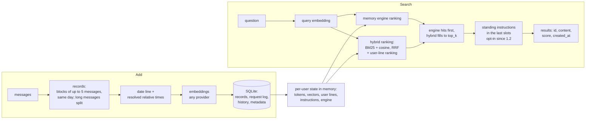

# Tidemark architecture

Tidemark is a memory service for AI assistants and agents: it stores conversations per user and returns the
records most relevant to a question. It never writes answers itself; the caller's model does.

## Components

| Part | Where | Size |
|---|---|---|
| HTTP service: Add, Search, memory management, auth, limits | `src/main.rs`, `src/api.rs` | ~2,300 lines |
| Hybrid ranking, tokenization (incl. CJK bigrams), user lines, instruction detection | `src/search.rs` | |
| Embedding client (OpenAI-compatible, Azure, Gemini, Cohere, Voyage, Jina, Ollama, TEI, JSON template; batched, parallel, retried, token counting) | `src/embed.rs` | |
| Model switch for a database (`tidemark reembed`) | `src/reembed.rs` | |
| Date notes (relative times resolved against each message's date) | `src/dates.rs` | |
| Optional reranker: local cross-encoder (ONNX) or API (Cohere-compatible, Jina, Voyage, TEI, DashScope, JSON template) | `src/rerank.rs` | |
| Shared HTTP client pieces (retries, headers, templates) | `src/http.rs` | |
| Preference memory: extraction (rules or model, verified evidence), versioned store, search slots | `src/preferences.rs` | |
| Optional language model (`TIDEMARK_LLM_*`, via the engine's `ChatModel`: OpenAI-compatible, Anthropic, Gemini, custom, command) | `src/llm.rs`, `engine/src/chat.rs` | |
| Memory engine (library) | `engine/` | ~64,000 lines |

Of the engine, the service uses ingestion and retrieval: the write gate, meta-memory scores, derived episode
memories, query intents (temporal, procedural, preference …), temporal-relation clauses and latest-state handling.
About 28,000 lines are answer generation and statement-by-statement verification and about 13,000 summarization;
they are library code and are not exposed over HTTP.

## Add

1. **Records.** Consecutive messages of one Add request form records of up to 5 messages (`TIDEMARK_WINDOW`) from
   the same calendar day. A message longer than 300 words or 2,000 characters is split into overlapping parts
   (20 % overlap) and stored on its own. Each record keeps the message text verbatim.
2. **Dates.** A record starts with its first message's date and time. Relative expressions are resolved against the
   message's own date by deterministic rules and noted next to the text, e.g. `[time: yesterday = 7 May 2023]`.
   Week-based expressions stay relative ("the week before 8 May 2023").
3. **Embeddings.** One vector per record: the messages themselves, or for a split message the part's own words led
   by the speaker, embedded as documents (questions are embedded as queries, for providers that distinguish them).
   Inputs are capped at 6,000 characters (`TIDEMARK_EMBED_MAX_CHARS`), sent in batches, 4 requests at a time.
4. **Durability.** Records, the request log (per user and request ID, so retries are safe) and the embedding model's
   identity are written in one SQLite transaction before Add returns. A database whose recorded model or vector
   dimensions differ from the configuration is refused at start; `tidemark reembed` moves it to another model.

## Search

1. **Engine ranking.** The user's memory engine ranks first and returns the records it judges relevant. Its hits can fill
   all `top_k` places; then the hybrid ranking below has no influence on the results. (Observed for every case of the
   development diagnostic suite at `top_k` 10, on conversations of about 35 records; how often it happens elsewhere is
   not measured.)
2. **Hybrid ranking.** BM25 over record text (including dates and time notes) and cosine similarity of the query
   embedding are fused by reciprocal rank (k = 60, equal weights). A second ranking over the lines the text marks as
   the user's (`user: …`) is added with weight 1.
3. **Merge.** Engine hits come first; the hybrid ranking fills the remaining places up to `top_k`, if any remain.
4. **Standing instructions.** User lines that state an instruction or preference ("Always …", "Never …", "From now
   on …", "I prefer …") take up to 10 final slots, at most a tenth of `top_k`.
5. **Optional.** A cross-encoder can re-order the hybrid candidates or the combined list (`TIDEMARK_RERANK_SCOPE`);
   results can be capped by count or characters. All off by default.

## Preferences

Preferences are kept apart from records: a statement, when it applies, the user's own words as evidence, the source
record, a version and a status. The rules find them inside Add; with `TIDEMARK_PREFERENCES=llm` a durable queue feeds
the model after Add returns, and code keeps only proposals whose evidence is verbatim in the record's user text.
Search appends the most relevant current preferences when `preference_slots` asks for them. Deleting or correcting a
memory retracts the preferences drawn from it; `tidemark reembed` moves their vectors with the records'.

## Memory management

`GET /memories`, `GET|PATCH|DELETE /memories/{id}`, `GET /memories/{id}/history` and `DELETE /users/{user_id}`
work on one user's memories only. Every change runs under the user's lock, is durable when it returns, and drops
the user's in-memory state, so the next Search rebuilds it from SQLite. A correction is re-embedded; its previous
text, and the last text of a deleted memory, are kept in the history until the user is deleted.

## State and scale

SQLite holds everything. Users recently searched or written are held in memory (least recently used evicted beyond
`TIDEMARK_CACHE_MB`, default 2 GB); a user not in memory is reloaded on demand (about 1–3 s for a LongMemEval-size
history, 20–35 s for a 1M-token history). Requests beyond `TIDEMARK_MAX_CONCURRENT` get HTTP 429 with `Retry-After`.

## Known limitations and direction

- **One record, many jobs.** A record is the unit of storage, embedding, ranking and returned context. Finding a fact,
  understanding a reply and establishing a change need different units; a fixed block cannot serve all of them.
- **Relevance per record.** Ranking judges records one at a time. Summaries and event orderings need a complementary
  set: distinct events, the dates of changes, conflicting statements side by side.
- **Engine priority is not supported by current retrieval measurements, but it stays the default.** The only measurement
  that favoured engine first used placeholder embeddings: LoCoMo all@10, 74.1% vs 72.5%. With real embeddings
  (text-embedding-v4) and the same `top_k` 10, hybrid-only (`TIDEMARK_BACKEND=builtin`) retrieved more of the needed
  evidence in every test so far:

  | Test | Engine first | Hybrid only |
  |---|---|---|
  | Author-built development suite: essential items | 6 / 21 | 17 / 21 |
  | Author-created holdout: essential items | 8 / 21 | 16 / 21 |
  | LoCoMo, 10 conversations, categories 1–4: evidence-turn recall | 66.4% | 77.0% |
  | LoCoMo, 1,977 questions: all@10 | 73.2% | 81.9% |
  | LongMemEval-S, 54 questions: recall of turns that contain the answer | 69.0% | 88.5% |

  - Hybrid-only was no slower and returned less or equal text.
  - **Losses:** hybrid-only also loses evidence that the engine finds. On LoCoMo it lost 99 evidence turns against 374
    gained, mostly in multi-hop list and aggregation questions. 81 of those 99 still appear in its top 25.
  - **At `top_k` 25** the two backends are close.
  - **Answers:** an improvement in answers has not been established. On the holdout (21 cases, free-response answers,
    blind scoring), hybrid-only passed support and compliance in 95 of 105 replies against 89. The case-level 95%
    interval included zero, so the result is inconclusive. In two cases the answers misused evidence that hybrid-only
    had retrieved.
  - **Caveats:** both public datasets were used during development, and the suites were written by the same author who
    scored them.
  - **Decision:** engine first stays the default, and hybrid-only remains a candidate. The next test runs both backends
    through a full answer pipeline, with evidence binding and verification, measuring grounded correctness, constraint
    compliance and personalization.
- **Budget in records,** not in reading cost: 100 results can be very different amounts of text.
- **Input format.** The user-line ranking and instruction slots act on `user: …` lines. Inputs that name speakers
  (`Caroline: …`) or carry source tags give them little to act on; tag-aware parsing is future work.

The intended direction is three explicit stages: **preserve** original messages with speakers, timestamps and
provenance; **find** with hybrid retrieval over suitable indexed units; **assemble** a compact, complementary set of
source passages that keeps necessary context and conflicting statements.
